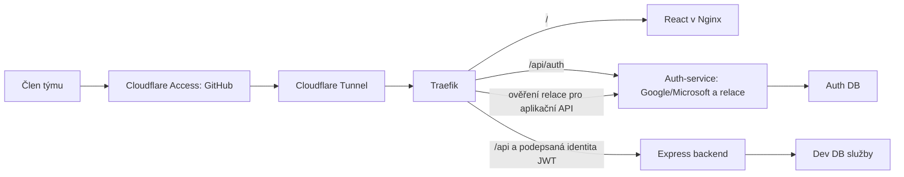

# AniCo: vysvětlení pro tým

**Vyvíjíme lokálně, společný výsledek ověřujeme na devu.**
Backendoví vývojáři používají osobní DB podle služby. Frontend může volat
společné dev API, nebo jednu lokální službu; nasazený dev má společná data.
Produkce bude samostatná a veřejná, zatím není nasazená.
Hotové a chybějící části: [aktuální stav projektu](STAV-PROJEKTU.md).

## Co dělá který nástroj

| Nástroj                      | Proč jej máme                                                |
| ---------------------------- | ------------------------------------------------------------ |
| Node.js + TypeScript         | Běh backendu a kontrola typů                                 |
| Express                      | HTTP routy backendu; běží nad Node.js                        |
| React + Vite                 | UI, rychlý lokální vývoj a build pro prohlížeč               |
| MongoDB + Mongoose           | Dokumentová DB a přístup k uloženým datům                    |
| Zod                          | Validace vstupů a společné kontrakty frontendu/backendu      |
| Pino                         | Strukturované logy HTTP a aplikace                           |
| npm workspaces + Turborepo   | Jeden repozitář, společné závislosti a správné pořadí buildů |
| Vitest + Supertest           | Unit testy a ověřování HTTP endpointů                        |
| mongodb-memory-server        | Vlastní dočasná MongoDB pro testy                            |
| Prettier, Husky, lint-staged | Automatické formátování souborů před commitem                |
| Changesets                   | Řízené verze a changelogy                                    |
| GitHub Actions + Gitleaks    | Kontroly změn, sken secrets a build/publish images           |
| Docker + GHCR                | Balení aplikací a uchování sestavených images                |
| Coolify + Traefik            | Spouštění služeb a směrování požadavků                       |
| Hetzner                      | VPS, na kterém služby běží                                   |
| Cloudflare Access + Tunnel   | HTTPS, týmové GitHub přihlášení a privátní spojení k VPS     |
| Pulumi + Ansible             | Předpis cloudových prostředků a konfigurace serveru jako kód |

## Jak jde požadavek do devu

Docker na VPS nezveřejňuje aplikační ani DB porty přímo do internetu.
Administrace je na `admin.anico.online`, aplikace na `dev.anico.online`.
GitHub přihlášení k devu je přístup týmu. Samotný uživatel AniCo se na devu
přihlašuje přes Google nebo Microsoft; backend ověřuje podepsanou identitu. Oba poskytovatelé jsou
nasazení a přihlášení i odhlášení je potvrzené v prohlížeči.

## Jak jde změna od vývojáře na server

1. Stáhnu `dev`, založím feature větev, nebo aktualizuji svou existující větev
   a začlením do ní `dev` podle [Git workflow](GIT-WORKFLOW.md). Vyberu režim: `dev:frontend`,
   `dev:backend -- --service animal`, nebo `dev:fullstack -- --service animal`
   (vše přes `npm run` z kořene).
2. Upravím kód, ověřím jej a otevřu PR do `dev`.
3. CI a code owner review rozhodnou, zda lze změnu sloučit.
4. Po úspěšných kontrolách merge do `dev` vzniknou images v GHCR. Deploy job
   je předá Coolify podle konkrétních digestů a ověří zdraví všech tří komponent.

Na VPS se aplikace nekompilují. Nová mikroservisa potřebuje vlastní odpovědnost,
API kontrakt, image a konfiguraci nasazení; není to jen další složka.

## Co ještě není hotové

Google i Microsoft login/logout na devu funguje. Volitelné propojení účtů je nasazené, ale vlastník ho nevyužívá.
Tato změna doplňuje lokální přihlášení a čeká na nasazení/ověření. Zbývá napojení business UI na API,
autorizace jednotlivých domén a doručování registrace další službě.
Message broker není nasazený. Apple a produkci jsme odložili. Provozní limity,
monitoring a zálohy s testem obnovy ještě zbývají.
IaC obnoví nastavení, **nikoli ztracená data bez záloh**.

Na začátek stačí [vývojářský návod](MANUAL-PRO-VYVOJARE.md) a [tahák příkazů](PRIKAZY.md).
Správcovské detaily nejsou potřeba pro každodenní programování.
