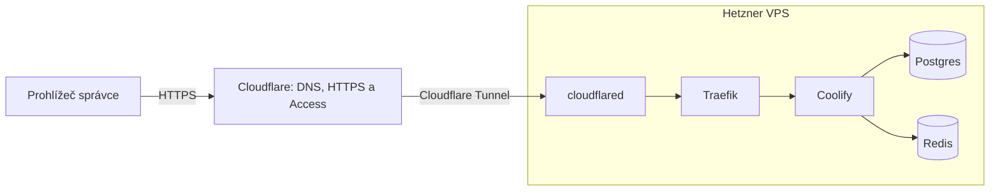

# AniCo: co jsme připravili, proč a jaké nástroje používáme

**Aktualizace 29. 10. 2026:** administrace používá GitHub-only přihlášení
v Cloudflare Access i přímé GitHub OAuth v Coolify, bez běžného Coolify hesla.
Owner má původní účet; šest kolegů má připravené vlastní Admin účty. E-maily
jsou pouze v soukromé šifrované konfiguraci. Dev je dál zavřený a aplikace
dev/prod ještě nejsou nasazené. Provozní postup: [COOLIFY-SSO.md](../infrastructure/COOLIFY-SSO.md).
Níže uvedený text je původní historický přehled z počátečního nastavování.

Podklad pro týmovou přednášku, stav k **22. 10. 2026**.
Předpokládaná délka: 15–20 minut plus diskuse.

**Doplnění z 26. 10. 2026:** do monorepa přibyl minimální frontend React +
TypeScript + Vite v `apps/frontend`. Vite zajišťuje vývojový server a build;
React vykresluje uživatelské rozhraní. Jde zatím o úvodní stránku bez API integrace
a bez nasazení na VPS. Pro nástup kolegů je připravený
[manuál pro vývojáře](MANUAL-PRO-VYVOJARE.md). Zbytek textu zachycuje původní přehled infrastruktury.

## 1. Cíl dosavadní práce

Připravili jsme základ repozitáře a infrastrukturu pro školní projekt AniCo.
Chceme provozovat vývojové a produkční prostředí na jednom serveru, mít bezpečný
přístup ke správě a dokázat nastavení znovu vytvořit po výpadku serveru.

Zatím jsme připravovali hlavně provozní základ. Celý aplikační stack ještě
musí odsouhlasit tým; současná ukázková služba není hotová produkční aplikace.

Tři hlavní principy:

1. **Opakovatelnost:** nastavení serveru a cloudových služeb zapisujeme jako kód.
2. **Oddělení prostředí:** dev nemá používat produkční data, účty ani secrets.
3. **Přiměřená složitost:** jeden server, Docker a nástroje odpovídající velikosti projektu.

## 2. Co už funguje a co zatím čeká

| Oblast                                                | Stav                                                                    |
| ----------------------------------------------------- | ----------------------------------------------------------------------- |
| Monorepo, ukázkový backend, sdílená schémata a testy  | Připravené v pracovním repozitáři                                       |
| CI a verzovací workflow pro GitHub Actions            | Soubory připravené; aktivace závisí na uložení do GitHubu a oprávněních |
| Hetzner VPS, Docker a nastavení logování              | Běží                                                                    |
| Oddělené Docker sítě, adresáře a volumes pro dev/prod | Vytvořené; aplikační databázové volumes jsou zatím prázdné              |
| Coolify a interní reverzní proxy Traefik              | Běží                                                                    |
| `admin.anico.online` přes Cloudflare Tunnel a Access  | Funguje, včetně ověřeného přihlášení v prohlížeči                       |
| Hetzner firewall                                      | Aktivní                                                                 |
| Místní recovery kopie a ověření obnovy Pulumi state   | Připravené a vyzkoušené                                                 |
| Přihlášení přes GitHub                                | Dohodnutá další varianta, dosud nenastavená                             |
| Aplikace a jejich databáze na dev/prod                | Dosud nenasazené                                                        |
| Automatické zálohy mimo VPS a kopie secrets mimo Mac  | Dosud nenastavené                                                       |
| Úplná obnova na náhradním VPS                         | Dosud nevyzkoušená                                                      |

Připravené soubory samy o sobě neznamenají commit, push nebo úspěšný běh CI
na GitHubu. Zdrojový předpis musí být bezpečně uložený i ve vzdáleném repozitáři.

## 3. Monorepo: jeden repozitář, více samostatných částí

```text
anico/
├── apps/
│   └── breeding-service/       # první ukázková backendová služba
├── packages/
│   └── shared-schemas/         # sdílené API kontrakty
├── infrastructure/            # konfigurace serveru a cloudu
├── docs/                      # vysvětlení a podklady pro tým
└── .github/workflows/         # připravené automatické kontroly
```

**NPM workspaces** propojují balíčky v jednom repozitáři. Spravujeme závislosti
z jednoho kořene a služba může používat lokální balíček `@anico/shared-schemas`.
Workspaces mapují `apps/*`, `packages/*` i `infrastructure`.

**Turborepo** řídí spouštění úloh a jejich závislosti. Například nejdřív sestaví
sdílená schémata a potom službu, která je používá. Pro vhodné úlohy využívá cache.
Nemá na starosti kontejnery ani provoz serveru.

**`package-lock.json` a `npm ci`** umožňují instalovat stejné zaznamenané verze
závislostí. Lockfile patří do Gitu, `node_modules` ne.

Monorepo neznamená, že všechny služby musí běžet jako jeden proces. Samostatné
nasazování služeb doplníme podle finální architektury.

## 4. Node.js, TypeScript a Express: tři různé úlohy

| Nástroj    | Co dělá                                       | Proč ho máme                         |
| ---------- | --------------------------------------------- | ------------------------------------ |
| Node.js    | Spouští JavaScript na serveru                 | Běhové prostředí backendu            |
| TypeScript | Kontroluje typy a překládá se do JavaScriptu  | Pomáhá zachytit chyby před spuštěním |
| Express 5  | Obsluhuje HTTP požadavky, routy a middleware  | Základ REST API                      |
| `tsx`      | Spouští TypeScript při vývoji a sleduje změny | Pohodlný vývojový režim              |

Používáme tedy **Node.js + TypeScript + Express**, nikoli jednu z těchto
technologií místo ostatních. Produkční skript služby spouští sestavený JavaScript.

Současný backend obsahuje ukázkovou práci s chovnými plány, validaci vstupů,
zpracování chyb a endpoint `/health`. Při startu validuje konfiguraci pomocí
Zodu a připojuje databázi. Při ukončení přestane přijímat nové HTTP požadavky
a uzavře databázové spojení.

`/health` je zatím základní liveness kontrola. Není úplnou kontrolou připravenosti
všech závislostí služby.

## 5. Zod, MongoDB a Mongoose

**Zod** ověřuje skutečná data za běhu aplikace. TypeScript sám nezaručuje,
že příchozí JSON odpovídá očekávanému typu. Zod umožňuje validovat například
jméno chovného plánu a odvodit TypeScript typ pomocí `z.infer`.

**`@anico/shared-schemas`** obsahuje sdílená Zod schémata a odvozené typy.
Je to společný popis API kontraktů. Schémata se sestavují do JavaScriptu
a deklarací typů, které ostatní balíčky importují.

**MongoDB** ukládá dokumenty. **Mongoose** je knihovna pro přístup k MongoDB,
modely a práci s dokumenty. Zod a Mongoose se doplňují: Zod kontroluje hranice
API, Mongoose řeší databázovou vrstvu. Zod automaticky nevytváří naši databázi
ani nenahrazuje její přístupová oprávnění.

V aktuální službě používáme Mongoose. Přechod na přímé používání native driveru
jsme neprovedli. Ani přejmenování složek na `abl`/`dao`/`controller` není schválené.

## 6. Clean Architecture: pravidla aplikace oddělená od technologií

Uvnitř služby je zatím struktura podle doménových modulů:

```text
modules/breeding/
├── domain/          # doménové typy a rozhraní pro ukládání dat
├── application/     # use case: co aplikace provádí
├── infrastructure/  # konkrétní implementace přes Mongoose
└── http/            # Express routy a převod HTTP vstupů/výstupů
```

Use case dostane rozhraní pro ukládání dat. Nemusí vědět, jak Express obsluhuje
požadavek nebo jak Mongoose komunikuje s MongoDB. Konkrétní implementace se
propojí při startu služby.

To usnadňuje testování logiky i případnou výměnu technologií. Princip závislostí
je důležitější než samotný název složky; označení `repository` zde znamená
rozhraní pro práci s uloženými daty, tedy roli blízkou známému DAO.

## 7. Kvalita kódu, logování a testy

| Nástroj                 | Úloha                                                              |
| ----------------------- | ------------------------------------------------------------------ |
| Prettier                | Jednotné automatické formátování                                   |
| Husky                   | Spuštění Git hooku před commitem                                   |
| lint-staged             | Formátování jen souborů připravených do commitu                    |
| Changesets              | Popis změn, sémantické verzování a changelog s hlavní větví `main` |
| Pino                    | Strukturované JSON logy aplikace                                   |
| `pino-http`             | Logování HTTP požadavků v Expressu                                 |
| Vitest                  | Unit a integrační testy aplikace                                   |
| Supertest               | Testovací HTTP požadavky proti Express aplikaci                    |
| `mongodb-memory-server` | Dočasný skutečný proces MongoDB pro integrační testy               |
| coverage-v8             | Měření pokrytí aplikačního kódu testy                              |
| GitHub Actions          | Připravené CI kontroly a workflow pro verzovací PR                 |

Unit testy ověřují aplikační logiku bez databáze. Integrační testy používají
HTTP vrstvu a dočasnou MongoDB, takže ověřují i ukládání dat. Nesahají na běžnou
dev nebo produkční databázi. `mongodb-memory-server` může při prvním spuštění
stahovat databázovou binárku; název neznamená pouhou JavaScriptovou napodobeninu DB.

Pino v současné konfiguraci rediguje autorizační hlavičku a cookies. Rotace
kontejnerových logů pak řeší Docker: jsou to dvě různé vrstvy logování.

Prettier neprovádí pravidlovou analýzu jako ESLint a samotná úspěšná typová
kontrola nenahrazuje spuštění testů. Changesets workflow zatím balíčky nepublikuje
do npm registru a CI zatím neprovádí automatické nasazení na server.

## 8. Server: Hetzner a Ubuntu

**Hetzner Cloud** poskytuje naše VPS, tedy virtuální server. Používáme jeden
existující server s Ubuntu 26.04, 2 vCPU, 4 GB RAM a přibližně 40 GB disku.
Pro školní projekt tím držíme infrastrukturu malou a srozumitelnou.

**Ubuntu** je operační systém hostitele. Spravuje procesy, síť, disk a Docker.
**SSH** slouží k zabezpečené administraci a Ansible ho používá pro konfiguraci.
Pro správu máme SSH klíč a alias `anico-server`.

Jeden server znamená společnou kapacitu i společný bod výpadku. Oddělené kontejnery
nejsou náhradou druhého serveru nebo externí zálohy.

## 9. Docker, Compose, sítě a volumes

**Docker image** je předpis souborového prostředí pro službu.
**Kontejner** je spuštěný proces založený na image. **Docker Compose** popisuje
skupinu služeb, jejich sítě, volumes a provozní nastavení.

- **Sítě** určují, které kontejnery spolu mohou komunikovat.
- **Volumes** uchovávají data odděleně od životnosti konkrétního kontejneru.
- **Healthcheck** zjišťuje zdraví služby; běžný Compose tím sám nezaručuje její restart.
- **Restart policy** určuje obnovení kontejneru po pádu nebo startu Dockeru.
- **Image digest** připíná konkrétní obsah image, nejen její měnitelný tag.

Připravili jsme samostatné aplikační a datové sítě, volumes a adresáře pro
`anico-dev` a `anico-prod`. Datové sítě mají `internal: true`. Databázové porty
nebudou veřejně publikované.

Management má vlastní síť a interní datovou síť pro Coolify. Správce hostitele
nebo Dockeru má přesto rozsáhlý přístup; síťová izolace před ním data neochrání.

Pro Docker jsme nastavili:

- Log driver `local` s rotací přibližně 10 MB × 3 soubory na kontejner.
- `live-restore`, aby běžící kontejnery mohly přežít restart Docker daemonu
  v podporovaných situacích. Nezajišťuje přežití rebootu celého VPS.
- Automatický start Dockeru a restart policies dlouhodobých management služeb.

CPU/RAM limity aplikací, monitoring kapacity a pravidla čištění images
doplníme při společném nasazení finálního stacku.

## 10. Coolify a Traefik

**Coolify** je self-hosted nástroj s webovým rozhraním pro správu nasazování.
Používáme ho na vlastním VPS, bez předplatného Coolify Cloud. Má nám usnadnit
správu aplikací, konfigurace a nasazení, až budou připravené.

Instalaci Coolify, základní nastavení a hlavní proxy konfiguraci vlastní náš
IaC předpis. Budoucí aplikace a jejich nasazení bude spravovat Coolify.
Samotné naklikání projektu v UI se automaticky nepřenáší do Pulumi kódu.

S Coolify běží:

| Komponenta | Účel                                                                   |
| ---------- | ---------------------------------------------------------------------- |
| Postgres   | Interní databáze konfigurace Coolify; není aplikační databází AniCo    |
| Redis      | Podpůrná služba pro běh Coolify, například fronty/cache                |
| Sentinel   | Agent používaný Coolify pro správu a sledování serveru                 |
| Traefik    | Reverzní proxy, která směruje HTTP požadavky na správné interní služby |

**Reverzní proxy** přijme požadavek na doménu a předá jej odpovídající službě.
Traefik tuto roli plní uvnitř serveru. Caddy by uměl podobnou roli, ale v současném
řešení jsme zvolili Traefik integrovaný s Coolify; Caddy zde neběží.

Coolify je dostupné na `admin.anico.online`. Jeho pomocné hostitelské porty jsou
vázané pouze na loopback a Traefik nepublikuje veřejné hostitelské porty.

## 11. Cloudflare: DNS, Tunnel a Access

Tyto tři části mají odlišný účel:

| Komponenta        | Co řeší                                                                                     |
| ----------------- | ------------------------------------------------------------------------------------------- |
| Cloudflare DNS    | Kam má doménové jméno směrovat                                                              |
| Cloudflare Tunnel | Jak doručit provoz z Cloudflare k interní službě bez otevření příchozích webových portů VPS |
| Cloudflare Access | Kdo smí k chráněné aplikaci přistoupit                                                      |
| `cloudflared`     | Konektor běžící na VPS, který vytváří odchozí spojení k Tunnelu                             |

Současná cesta do administrace:



Šipky ukazují doručení požadavku. Spojení samotného Tunnelu navazuje konektor
směrem ven z VPS. Veřejné HTTPS ukončuje Cloudflare; interní HTTP komunikace
proxy a Coolify probíhá po Docker síti a nemá veřejně otevřený port.

Access dnes ověřuje povolený e-mail jednorázovým kódem. Poté se správce
přihlašuje samostatným účtem Coolify. První ověření je vstup do chráněného
prostředí, druhé určuje účet a oprávnění uvnitř aplikace.

Doména chráněná Access může být veřejně zjistitelná. Ochrana spočívá v ověření
přístupu, ne v utajení názvu domény. Přístup bez potřebných oprávnění nedostane
obsah Coolify a přímý veřejný přístup na jeho origin porty je zavřený.

### Dohodnutý další krok: GitHub přihlášení, bez VPN

Pro pohodlnější týmový přístup chceme přidat GitHub jako poskytovatele identity
v Cloudflare Access. To zatím není nastavené. Počítáme s oddělenými oprávněními
pro vývojáře a správce, zabezpečenými GitHub účty a vlastními účty v Coolify.

Přihlášení přes GitHub v Access automaticky nenahrazuje přihlášení do Coolify.
VPN, Tailscale ani WARP jsme neinstalovali a VPN používat nechceme.

## 12. Veřejná produkce, soukromý dev a soukromá správa

| Adresa               | Cílový účel                                                 | Stav                            |
| -------------------- | ----------------------------------------------------------- | ------------------------------- |
| `anico.online`       | Veřejná produkční aplikace s vlastní autentizací/autorizací | Aplikace zatím nenasazená       |
| `dev.anico.online`   | Týmové vývojové prostředí za Access                         | Zatím nepublikované přes Tunnel |
| `admin.anico.online` | Správa nasazení přes Coolify za Access                      | Funguje                         |

Produkci nebudeme omezovat týmovým Access přihlášením. Naopak přístup k devu
sám o sobě nesmí dávat oprávnění ke správě produkce.

Root/dev DNS zůstaly původní A záznamy. Jejich budoucí přepnutí na Tunnel bude
samostatná řízená změna. Nemáme zatím nasazenou kompletní dev/prod aplikaci.

**Hetzner firewall** je další ochrana před serverem: povoluje příchozí SSH
jen z administrátorské IP a ICMP pro diagnostiku. Ostatní příchozí provoz
je blokovaný, odchozí je povolený. Proto funguje odchozí Tunnel, ale veřejně
neotevíráme porty MongoDB ani porty Coolify. Firewall spravujeme přes Pulumi.

## 13. Pulumi a Ansible: infrastruktura jako kód

**Infrastructure as Code (IaC)** znamená, že požadované nastavení ukládáme
do souborů a aplikujeme nástrojem. Nemusíme po výpadku zpaměti opakovat desítky
ručních kroků. Změny jsou čitelné, kontrolovatelné a po uložení do Gitu verzované.

| Nástroj | Jeho hranice v AniCo                                                                         |
| ------- | -------------------------------------------------------------------------------------------- |
| Pulumi  | Přes API nastavuje Cloudflare Tunnel, Access, příslušné DNS a Hetzner firewall               |
| Ansible | Přes SSH připravuje Ubuntu hostitele, Docker, sítě, volumes, soubory a management kontejnery |
| Coolify | Bude spravovat aplikační nasazení; zatím je připravená management instalace                  |

Pulumi používáme s TypeScriptem, Ansible s YAML playbooky. Nejsou to dvě
alternativní implementace téhož: jedno spravuje cloudové prostředky, druhé hostitele.

**Pulumi preview** ukáže plán změn; **Pulumi up** je aplikuje. Kritické prostředky
mají ochranu proti odstranění. Program nyní pouze vyhledává existující VPS;
nevlastní jeho životní cyklus a sám ho nevytváří ani nemaže.

**Pulumi state** obsahuje vazbu mezi předpisem a existujícími cloudovými prostředky.
Ukládáme ho lokálně na Macu a secrets v něm jsou šifrované passphrase. Nepoužíváme
Pulumi Cloud. Ztráta stavu nebo passphrase by obnovu významně zkomplikovala.

**Idempotence** znamená, že opakované spuštění se stejnou konfigurací nemá
zbytečně měnit již správný stav. U Coolify jsme ověřili opakovaný Ansible běh
s nulou změn; po připojení firewallu Pulumi preview neplánovalo další změny.

## 14. Secrets, Git a obnova

Do Gitu patří kód, konfigurační šablony, playbooky, neprivátní předpisy a lockfile.
Nepatří tam API tokeny, hesla, privátní klíče, `.env` hodnoty, Pulumi state nebo
databázové zálohy. `.gitignore` jsme rozšířili i pro lokální tooling, klíče a zálohy.

Provedená kontrola 104 kandidátních souborů nenašla uložené lokální přihlašovací
údaje ani kontrolované běžné formáty privátních klíčů. To není záruka odhalení
libovolného budoucího secretu. Gitignore navíc nesmaže secret, který už někdo commitnul.

Při úvodním nastavování se do dřívějšího technického výpisu dostaly instalační
secrets. Kontrola byla opravena, aby je nevypisovala. Staré výpisy nesdílíme;
navazující řešení citlivých údajů je zaznamenané v provozním checklistu.
Tento dokument neobsahuje skutečné hodnoty tokenů, hesel ani privátních klíčů.

Připravili jsme dva pomocné příkazy:

```bash
npm run recovery:create -w @anico/infrastructure
npm run recovery:verify -w @anico/infrastructure -- /CESTA/KE/SNAPSHOTU
```

První uloží export Pulumi state a potřebnou soukromou konfiguraci do ignorované
lokální složky. Druhý ověří checksumy, import do izolovaného dočasného backendu
a skutečné dešifrování Tunnel tokenu bez jeho vypsání.

Recovery kopie obsahuje i plaintext secrets a passphrase, je omezená souborovými
právy, nikoli šifrovaným archivem. Zůstává na stejném Macu. Není zálohou mimo
zařízení, neobsahuje serverová data ani automaticky uchovaný zdrojový repozitář.

Při ztrátě VPS vytvoříme náhradní server, nastavíme SSH a nové ID/IP, upravíme
Pulumi konfiguraci a spustíme bootstrap. **IaC obnovuje nastavení; databázová
data a projekty Coolify vyžadují vlastní zálohy.** Úplnou obnovu na novém VPS
ještě musíme vyzkoušet.

## 15. Lokální vývoj proti vzdálené databázi

Probírali jsme možnost spouštět aplikaci na notebooku a databázi mít na serveru,
aby každý nemusel samostatně instalovat a nastavovat MongoDB.

Navržený model, dosud nenasazený:

```text
Notebook vývojáře → šifrovaný SSH tunel → jeho neprodukční databáze
Nasazená dev aplikace                 → vlastní dev databáze
Produkční aplikace                   → oddělená produkční instance a data
```

V neprodukční MongoDB instanci mohou mít vývojáři samostatné logické databáze
a účty s oprávněním pouze ke své DB. Tím sdílíme databázový proces, ale nikoli
rozpracovaná data. Každý může nezávisle resetovat vlastní prostředí.

To stále znamená společnou serverovou kapacitu a závislost na internetu.
Tunelování potřebuje vlastní omezené účty a přístupy; běžným vývojářům nedáme
root přístup na server. Dosavadní SSH firewall povoluje jen správce.

Chceme jednotný seed a jeden spouštěcí příkaz. Název `npm run dev:remote` je
zatím jen návrh, nikoli existující skript. Alternativou je už připravená lokální
MongoDB přes `infrastructure/compose.yaml`. Automatické integrační testy zůstávají
nezávislé na sdílené vzdálené DB.

## 16. Jak jsme ověřovali, že nastavení funguje

- Aplikační základ má testy logiky, HTTP endpointů a persistence, typové kontroly
  a konfiguraci coverage. Jejich podrobnosti jsou v kořenovém README.
- Při dokončení infrastruktury prošlo 19 Node testů konfigurace/plánů, 7 Python
  testů a Ansible syntax checks; soubory prošly formátovací kontrolou.
- Po připojení firewallu jsme otevřeli nové SSH spojení, ověřili skutečná pravidla
  přes API a zkontrolovali zdraví Tunnelu i Coolify.
- Ověřili jsme privátní porty, interní SSH Coolify → hostitel, zavřenou registraci,
  HTTP routování administrace a WebSocket chování.
- Veřejná kontrola ověřila Access přesměrování, odmítnutí neplatného tokenu
  a přechod HTTP na HTTPS. Správce potvrdil úplné přihlášení v prohlížeči.
- Recovery zkouška ověřila import state a dešifrování secrets; poškozená kopie
  byla odmítnutá. Nenahrazuje to test obnovy databází a celého VPS.

Tyto výsledky popisují provedené kontroly, ne nepřetržitý monitoring nebo
záruku bezchybného budoucího provozu. Při přípravě tohoto přehledu jsme infrastrukturu
znovu nenasazovali.

## 17. Co dokončíme společně po dohodě na stacku

1. Potvrdit aplikační technologie a strukturu kódu v týmu.
2. Připravit Dockerfiles, image registry, nasazení a rollback.
3. Zavést týmové účty, GitHub přihlášení přes Access a přístupy k vývojovým DB.
4. Nasadit oddělený dev a produkci, doplnit jejich konfiguraci a aplikační zabezpečení.
5. Nastavit limity, monitoring, aktualizace a údržbu serveru.
6. Zavést automatické zálohy mimo VPS, šifrovanou recovery kopii mimo Mac
   a ověřit úplnou obnovu.

JWT přihlášení aplikace, OpenAPI generování, další bezpečnostní middleware
a message broker zatím nejsou hotovou součástí tohoto základu. Potřebu brokeru
i konkrétní knihovny rozhodneme podle výsledné architektury.

Detailní checklist: [NEXT-STEPS.md](../infrastructure/NEXT-STEPS.md).

## 18. Co lze kolegům ukázat při přednášce

1. Strukturu `apps`, `packages`, `infrastructure` a import sdíleného Zod schématu.
2. Oddělení use case a Mongoose implementace v ukázkové službě.
3. Jeden unit a jeden integrační test, případně spuštění `npm run test:unit`.
4. Diagram cesty prohlížeč → Access → Tunnel → Traefik → Coolify.
5. Přihlášení do `admin.anico.online` a současnou prázdnou projektovou část Coolify.
6. Ansible playbook a rozdíl mezi Pulumi `preview` a `up`.
7. Checklist odložených úkolů a rozdíl mezi obnovou konfigurace a obnovou dat.

Při sdílení obrazovky neotvírat `.env.local`, `.pulumi/coolify.env`, passphrase,
recovery snapshoty ani staré technické výpisy obsahující secrets.

## Související soubory

- [Aplikační základ a lokální spuštění](../README.md)
- [Infrastruktura](../infrastructure/README.md)
- [Cloudflare](../infrastructure/CLOUDFLARE.md)
- [Coolify](../infrastructure/COOLIFY.md)
- [Firewall](../infrastructure/FIREWALL.md)
- [Obnova](../infrastructure/RECOVERY.md)
- [Navazující práce](../infrastructure/NEXT-STEPS.md)
