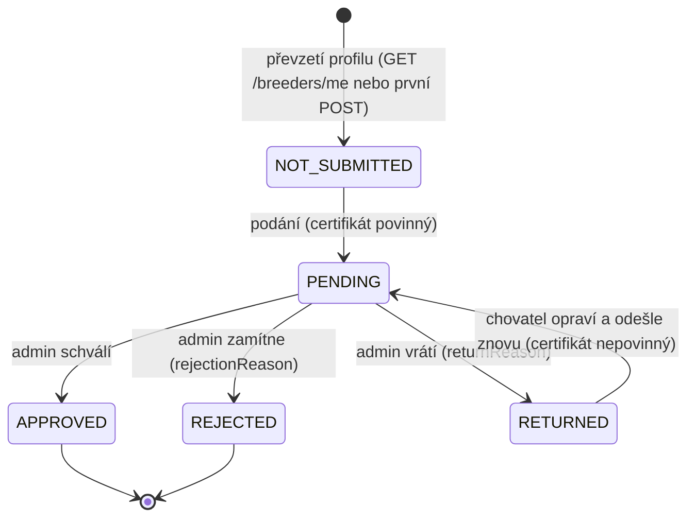

# UC-01 Ověřit chovatele – technický návrh (`breeder-service`)

Stav: návrh pro dokončení US-01. Závazné vstupy: brief koordinátora (rozhodnutí **K1–K17**), implementační průvodce
`backend-implementation-guide.md` (dále **P**, kapitoly/kroky), `business-model/05-business-use-cases.md` a
`04-products.md` (obojí zatím mimo repozitář, viz O15), [`docs/anico-domain.md`](../anico-domain.md).
Rozhodnutí: [ADR-0001](../adr/0001-zadost-o-overeni-vnorena-v-chovateli.md),
[ADR-0002](../adr/0002-identita-z-gateway-hlavicek.md), [ADR-0003](../adr/0003-e-mail-po-ulozeni-rozhodnuti.md),
[ADR-0004](../adr/0004-vraceni-zadosti-k-doplneni.md).
Návrh neopakuje průvodce; popisuje cílový stav a odchylky od P, skillů a existujícího kódu.

Aktualizace integrace 5. 11. 2026: původní doménový návrh zůstává podkladem,
ale identitu nahrazuje současný JWT kontrakt (§6, ADR-0002). Backend UC-01 je
lokální doplněk; `breeding-service`, společná auth a současný frontend zůstávají zachované.

Aktualizace 5. 11. 2026 (ADR-0004): vlastník produktu schválil vrácení žádosti k doplnění (`RETURNED`). Platný
stav popisuje §0; tam, kde se zbytek návrhu liší, platí §0 a kód.

## 0. Současný stav (ADR-0004)



- **Podání** `POST /breeders/me/verification-request` je povolené v `NOT_SUBMITTED` a `RETURNED`; v `PENDING`,
  `APPROVED` a `REJECTED` vrací 409 `{ error: 'Verification already submitted', current: MyAccount }`. Profil se
  při podání sám převezme z identity (`provision`), takže podání bez předchozího `GET /breeders/me` už nevrací 404.
- **Certifikát** je povinný vždy kromě opravy `RETURNED` (rozhoduje uložený stav, ne klient). Oprava bez souboru
  ponechá původní; nový soubor se uloží před zápisem a nahrazený se smaže až po úspěšném zápisu (selhání smazání
  se jen zaloguje). Oprava přepíše jméno, e-mail a údaje stanice.
- **Pořadí chyb podání:** 400 (nevalidní pole; chybějící soubor tam, kde je povinný – i ve stavu, kde by jinak
  přišlo 409) < 409 (stav neumožňuje podání) < 415 (obsah souboru není PDF/JPEG/PNG). 413 a 400 `Invalid upload`
  vrací už parser multipartu.
- **Rozhodnutí** `POST /verification-requests/:id/decision` (role `admin` nebo `owner`): `APPROVED`,
  `REJECTED` + `rejectionReason`, `RETURNED` + `returnReason` (oba po trim 1–500); každé rozhodnutí povinně nese
  `revision` – revizi podání, kterou admin posoudil (bez ní 400 `Validation failed`). Jen ze `PENDING` v téže
  revizi jedním podmíněným `findOneAndUpdate`; rozhodnutá žádost → 409
  `{ error: 'Verification already decided', current }`, `PENDING` v jiné revizi (mezitím vrácena a opravena) →
  409 `{ error: 'Verification revision mismatch', current }`; v obou případech bez e-mailu. Každé rozhodnutí se
  připíše do `reviewHistory` (`decision`, `revision`, `reviewedBy`, `reviewedAt`, `reason`);
  `reviewedBy`/`reviewedAt` nesou poslední rozhodnutí a po opětovném podání jsou v `PENDING` opět `null`.
- **Revize podání** (ADR-0004 bod 9): `revision` = 1 při prvním podání, oprava `RETURNED` → `PENDING` ji ve
  stejném zápisu zvýší o 1 (`$inc`), vrácení ji nemění. Optimistická kontrola: rozhodnutí načtené před vrácením
  a opravou nikdy neschválí novou, dosud neposouzenou verzi podání, přestože `requestId` zůstává.
- **Časy:** `submittedAt` = první podání (neměnné), `lastSubmittedAt` = poslední vstup do `PENDING`.
- **Fronta** `GET /verification-requests` bez `?status` vrací jen `PENDING`, s `?status=` žádosti v daném stavu;
  řazení `lastSubmittedAt` vzestupně, limit 500. `GET /verification-requests/summary` →
  `{ pending, returned, approved, rejected }` (chybějící stavy jako 0).
- **E-mail** (ADR-0003) i pro `RETURNED`: důvod a možnost žádost opravit a znovu odeslat. U `REJECTED`: důvod a
  věta, že zamítnutí je konečné a žádost nelze podat znovu. Vývojový adaptér e-mail nedoručuje, jen loguje.
- **Autentizace:** chybějící hlavička `x-anico-identity` → 401 `Authentication required`, neověřitelný JWT → 401
  `Invalid identity` (`@anico/auth`); bez nakonfigurovaného ověření (lokální `APP_ENV=local`) vrací vlastní
  `authenticate` služby 401 `Authentication required`. Ověřený uživatel bez role `admin`/`owner` na
  `/verification-requests*` → 403 `Insufficient permissions`.
- **Migrace** `migrations/20261105110409-verification-return-history.mjs` doplní existujícím žádostem
  `lastSubmittedAt` (= `submittedAt`), `returnReason: null` a `reviewHistory` (z dosavadního rozhodnutí), vytvoří
  index `{ verificationRequest.status: 1, verificationRequest.lastSubmittedAt: 1 }` a odstraní starý index nad
  `submittedAt`. Je idempotentní a **musí proběhnout před nasazením** (`db:migrate` nebo `MIGRATE_ON_START=true`).
- **Migrace** `migrations/20261105160000-verification-submission-revision.mjs` doplní žádostem bez `revision`
  revizi a položkám historie bez `revision` revizi, o které se rozhodlo: položka na indexu _i_ = 1 + počet
  `RETURNED` před ní; žádost = 1 + počet `RETURNED` v historii, ve stavu `RETURNED` jen počet `RETURNED` (poslední
  vrácení ještě nebylo opraveno), nejméně 1. Uložené hodnoty nepřepisuje (idempotentní), **musí proběhnout před
  nasazením**.
- **OpenAPI:** dokument se generuje ze Zod schémat (`src/openapi/document.ts`, artefakt `openapi.json`,
  `npm run openapi -w @anico/breeder-service`, drift hlídá `tests/unit/openapi-document.test.ts`). Swagger UI
  `GET /docs` a `GET /openapi.json` jsou veřejné jen mimo produkci; postup v [README služby](../../apps/breeder-service/README.md).

Otevřené body: produkční e-mail provider (O3), nasazení a gateway routa `/api/breeder` (O8), IČO a adresa chovatele
(nejsou v analýze; po upřesnění jako nová migrace, O17), GDPR retence (O6), chybějící analýza v `docs/business/`
(O15), N+1 metadat certifikátu (§9).

## 1. Rozsah a sledovatelnost

Pokrývá Převzetí účtu (HDS 1–3), UC-01 Příprava a první podání (HDS 1–7, A1–A3), Hlavní scénář – schválení
(HDS 1–9, A1–A4), Zobrazení výsledku a Common Alternative Flows; WF 01–05 a 07–11 (WF 06 analýza nemá).
Mimo rozsah: frontend (K17), WF 04 „Čekající doklady“ (UC-03), US-02+.

| Analýza                                 | Endpoint / komponenta                                     | Klíčový test (úroveň)                                                                    |
| --------------------------------------- | --------------------------------------------------------- | ---------------------------------------------------------------------------------------- |
| Převzetí účtu HDS 1–3, WF 01            | `GET /breeders/me` (JIT `provision`)                      | výchozí hodnoty R2; idempotence i 3× souběžně (http, int)                                |
| Podání HDS 1                            | `GET /breeders/me`                                        | `accountState: NOT_SUBMITTED`, `verificationRequest: null`                               |
| Podání HDS 2–3, A1 Zrušit, WF 02        | jen frontend                                              | backend nic neukládá – bez testu                                                         |
| Podání HDS 4, A2                        | `POST /breeders/me/verification-request`                  | 401, 400, 413, 415; nic se neuloží, ani soubor (http, int)                               |
| Podání HDS 4, A3                        | tamtéž                                                    | 409 + `current` v PENDING/APPROVED/REJECTED; souběh → `[201, 409, 409]`, 1 soubor        |
| Oprava vrácené žádosti (ADR-0004)       | tamtéž, `resubmitVerification`                            | RETURNED → PENDING; bez souboru původní certifikát, nový nahradí a starý se smaže        |
| Podání HDS 5–6 (uloží společně)         | `submitVerification` = 1 `findOneAndUpdate`               | profil + stanice + `PENDING` s `null` posouzením v 1 dokumentu; kompenzace souboru       |
| Podání HDS 7, WF 03                     | 201 `MyAccount`                                           | `accountState: PENDING`, `submittedAt`                                                   |
| Schválení HDS 1–2, WF 04, 05, 09        | `GET /verification-requests/summary`, `?status=`          | počty s nulami; filtr; řazení od nejstarší; rozhodnuté mizí z `PENDING`                  |
| Schválení HDS 3–4, WF 07                | `GET /verification-requests/:id`                          | detail + profil; nevalidní i neexistující id → 404                                       |
| Schválení HDS 5                         | `GET …/:id/certificate`, `GET /breeders/me/…/certificate` | bajty shodné; hlavičky §5; chovatel na admin cestě 403                                   |
| Schválení HDS 6–7                       | `POST /verification-requests/:id/decision`                | `APPROVED` + `isVerified` + `reviewedBy/At` + záznam v `reviewHistory` jedním zápisem    |
| Vrácení k doplnění (ADR-0004)           | `decision: RETURNED`                                      | `returnReason` povinný, `isVerified: false`, záznam v historii, e-mail s možností opravy |
| Schválení HDS 8                         | `DecisionNotifier` po uložení                             | volán 1× jen vítězným požadavkem; selhání → 200 + `warn`                                 |
| A1 Zamítnutí, WF 08                     | `decision: REJECTED`                                      | důvod uložen, `isVerified: false`; e-mail s důvodem a „zamítnutí je konečné“             |
| A3 Chybí důvod                          | tamtéž                                                    | chybí / `""` / `"   "` → 400, dokument beze změny                                        |
| A4 Jiný admin už rozhodl                | tamtéž                                                    | 409 + `current`; 2 souběžná → `[200, 409]` (int)                                         |
| Zastaralé rozhodnutí (ADR-0004 bod 9)   | tamtéž, `revision`                                        | po vrácení a opravě rozhodnutí o staré revizi → 409 `revision mismatch`, nic se nezmění  |
| Zobrazení výsledku, WF 10, 11           | `GET /breeders/me`                                        | všech 5 stavů, důvod u REJECTED/RETURNED, datum rozhodnutí                               |
| CAF – přístup při každém čtení a zápisu | všechny                                                   | 401 bez identity, 403 bez role, 404 neexistující/cizí                                    |

## 2. Datový model (MongoDB)

Jedna kolekce `breeders` (model `Breeder`), jeden dokument na chovatele, žádost vnořená (ADR-0001). Certifikát
v GridFS bucketu `breederCertificates` (`.files` + `.chunks`), typ obsahu v `metadata.contentType` (K3).

```text
breeders {
  _id: ObjectId
  breederId: string                 required, unique; = req.auth.userId, neměnné
  firstName, lastName, emailAddress: string | null   z identity, mohou chybět; podání je doplní
  breedingStationName, breedingStationNumber: string | null   default null
  isVerified: boolean               required, default false
  verificationRequest: null | {     default null
    _id: ObjectId                   = verification_request_id; doména `requestId`, API `id`
    status: 'PENDING' | 'APPROVED' | 'REJECTED' | 'RETURNED'
    submittedAt: Date               první podání, neměnné; nastavuje adaptér (K4)
    lastSubmittedAt: Date           poslední vstup do PENDING (podání nebo oprava RETURNED)
    revision: number                1 při podání, +1 při každé opravě RETURNED (ADR-0004 bod 9)
    breedingStationCertificate: { fileName, fileReference }   _id: false
    reviewedBy: string | null, reviewedAt: Date | null      poslední rozhodnutí; v PENDING null
    rejectionReason: string | null  jen u REJECTED
    returnReason: string | null     jen u RETURNED
    reviewHistory: [{ decision, revision, reviewedBy, reviewedAt, reason }]   všechna kola, nejstarší první
  }
}
```

Indexy (deklarované ve schématu, vytváří `Model.init()` v `server.ts` před `listen`, K10):

- `{ breederId: 1 }` unique – jeden profil na identitu; souběžné JIT převzetí → 11000 → znovu načíst (hotovo).
- `{ 'verificationRequest._id': 1 }` unique, partial `$exists: true` – vyhledání žádosti adminem (hotovo).
- `{ 'verificationRequest.status': 1, 'verificationRequest.lastSubmittedAt': 1 }` – fronta s filtrem; vytváří
  ji i migrace `20261105110409-verification-return-history.mjs`, která ruší původní index nad `submittedAt`.
- GridFS indexy vytváří driver při prvním zápisu.

Adaptér generuje `_id` žádosti explicitně (`new Types.ObjectId()`) v `$set` – nespoléhat na casting subdokumentu.

| Invariant                                 | DB / struktura                                                  | Zod                               | Use-case / doména                                     | Adaptér                                    |
| ----------------------------------------- | --------------------------------------------------------------- | --------------------------------- | ----------------------------------------------------- | ------------------------------------------ |
| Max. 1 žádost za život (R5, A3)           | vnoření + unique `breederId`; filtr `verificationRequest: null` | –                                 | `canSubmitVerificationRequest` (levná 409 předem)     | `null` = neuloženo                         |
| Oprava jen z RETURNED (ADR-0004)          | filtr `status: 'RETURNED'` + `requestId` + aktuální certifikát  | –                                 | `canSubmitVerificationRequest`, `requiresCertificate` | `null` = neuloženo → 409                   |
| Profil + žádost společně (R6)             | jeden `findOneAndUpdate`                                        | –                                 | pořadí soubor → DB → kompenzace (§4)                  | –                                          |
| Rozhodnutí jen z PENDING (R10, ADR-0004)  | filtr `status: 'PENDING'` + `revision` z rozhodnutí             | `revision` povinná, int ≥ 1       | `null` → znovu načíst → 404 / 409 (decided/mismatch)  | `$set` + `$push` do `reviewHistory`        |
| APPROVED ⇔ `isVerified: true` (R8, R9)    | stejný `$set`                                                   | –                                 | –                                                     | `isVerified = decision === 'APPROVED'`     |
| Důvod povinný u REJECTED a RETURNED       | – (viz §7 ř. 7)                                                 | `trim().min(1).max(500)`, strict  | prázdný po trim → `InvalidDecisionError`              | ukládá jen u daného výsledku, jinak `null` |
| Povinná pole podání                       | `required` ve schématu                                          | `SubmitVerificationRequestSchema` | –                                                     | –                                          |
| Formát certifikátu                        | –                                                               | –                                 | `detectCertificateContentType` (magic bytes)          | `metadata.contentType`                     |
| `breederId`, `reviewedBy` jen z identity  | –                                                               | `strictObject` odmítne cizí pole  | vstup use-case je z identity                          | –                                          |
| Po podání beze změn (R7) – kromě RETURNED | jediná další zapisovací cesta je oprava vrácené žádosti         | –                                 | –                                                     | `provision` jen `$setOnInsert`             |

Původní verze nepotřebovala migraci (servisa nebyla nasazena). Vrácení žádosti (ADR-0004) přidalo migrace
`20261105110409-verification-return-history.mjs` a `20261105160000-verification-submission-revision.mjs`, které
musí proběhnout před nasazením. `init()` vytvoří chybějící indexy, ale nezmění existující – pozdější změna
definice indexu = nová migrace.

## 3. API kontrakt

Schémata v `@anico/shared-schemas` (K15, existující exporty beze změny názvů; v `src/index.ts` už jsou):
`ObjectIdSchema`, `VerificationStatusSchema`, `accountSchema`, `CertificateFileSchema`, `StoredFileSchema`,
`VerificationRequestSchema`, `MyAccountSchema`, `BreederProfileSchema`, `UpdateMyProfileSchema`,
`SubmitVerificationRequestSchema`, `DecideVerificationRequestSchema`, `ListVerificationRequestsQuerySchema`,
`AdminVerificationRequestSchema`, `VerificationRequestListSchema`, `VerificationSummarySchema` + typy. Vstupy
`safeParse`, výstupy vždy `Schema.parse(...)` (i stávající `GET /breeders/me`, dnes bez `parse`).
Kdo rozhodl (`reviewedBy`, `reviewHistory`) obsahuje jen `AdminVerificationRequestSchema` (role `admin` | `owner`);
`VerificationRequestSchema` v `MyAccount` je pro chovatele a tato pole nemá (rozhodnutí 6. 11. 2026: chovatel
vidí jen výsledek, datum a důvod).

| Metoda a cesta                                      | Oprávnění                           | Vstup                                                                                   | Úspěch                                | Chyby                                                     |
| --------------------------------------------------- | ----------------------------------- | --------------------------------------------------------------------------------------- | ------------------------------------- | --------------------------------------------------------- |
| `GET /breeders/me`                                  | `authenticate`                      | –                                                                                       | 200 `MyAccountSchema` (založí profil) | 401, 500                                                  |
| `PATCH /breeders/me`                                | `authenticate`, vlastník = identita | strict JSON, alespoň jedno z `firstName`, `lastName`, `emailAddress`                    | 200 `MyAccountSchema`                 | 400, 401, 409 + `MyAccount`, 500                          |
| `POST /breeders/me/verification-request`            | `authenticate`, vlastník = identita | multipart: pole `SubmitVerificationRequestSchema` + soubor `breedingStationCertificate` | 201 `MyAccountSchema` (`PENDING`)     | 400, 401, 409 + `MyAccount`, 413, 415                     |
| `GET /breeders/me/verification-request/certificate` | `authenticate`                      | –                                                                                       | 200 soubor (§5)                       | 401, 404 (bez profilu / žádosti), 500                     |
| `GET /verification-requests/summary`                | `requireAdmin`                      | –                                                                                       | 200 `VerificationSummarySchema`       | 401, 403                                                  |
| `GET /verification-requests?status=`                | `requireAdmin`                      | `ListVerificationRequestsQuerySchema`                                                   | 200 `VerificationRequestListSchema`   | 400, 401, 403                                             |
| `GET /verification-requests/:id`                    | `requireAdmin`                      | `:id` (nevalidní ObjectId = neexistuje)                                                 | 200 `AdminVerificationRequestSchema`  | 401, 403, 404                                             |
| `GET /verification-requests/:id/certificate`        | `requireAdmin`                      | `:id`                                                                                   | 200 soubor (§5)                       | 401, 403, 404, 500                                        |
| `POST /verification-requests/:id/decision`          | `requireAdmin`                      | JSON `DecideVerificationRequestSchema`                                                  | 200 `AdminVerificationRequestSchema`  | 400, 401, 403, 404, 409 + `AdminVerificationRequest`, 413 |

- Pořadí middleware: `authenticate`/`requireAdmin` → (multer) → Zod → use-case. Neautentizovaný požadavek se
  nebufferuje do paměti. `/summary` je registrované před `/:id` (K6). Routery: `breeders-router.ts` + handler
  soubory podle `get-my-account-handler.ts`, `verification-requests-router.ts`; montáž v `app.ts` před 404.
- Tělo chyb (K7): `{ error }`; validace `{ error: 'Validation failed', issues }` (chybějící soubor také, s
  `path: ['breedingStationCertificate']`, aby frontend označil pole – A2); 401 `{ error: 'Authentication required' }`
  nebo `{ error: 'Invalid identity' }`, 403 `{ error: 'Insufficient permissions' }` (§0); 409 `{ error, current }`,
  kde `current` je `MyAccount` (chovatel) nebo
  `AdminVerificationRequest` (admin) – frontend zobrazí existující žádost (A3) / uložený výsledek (A4);
  chyby parseru multipartu → 400 `{ error: 'Invalid upload' }` (§5); nedekódovatelné URL (`URIError`, např.
  `/verification-requests/%E0`) → 400, ne 500; 500 `{ error: 'Internal server error' }` bez detailů.
  Texty `error` jsou konstanty na jednom místě.
- Mapování doménových chyb jen v jednom helperu modulu (`http/domain-errors.ts`, K7): `BreederNotFoundError` a
  `VerificationRequestNotFoundError` → 404, `VerificationAlreadySubmittedError`,
  `VerificationAlreadyDecidedError` a `VerificationRevisionMismatchError` → 409 + `current`,
  `CertificateRequiredError` → 400 `Validation failed`, `InvalidCertificateError` → 415, `InvalidDecisionError`
  → 400. Ostatní → `next(err)` → centrální 500.
- `current` i úspěšné odpovědi staví „presentery“ v `http/` (mapper + `files.getMetadata` + `Schema.parse`).
  Chybějící metadata = chyba konzistence → 500 + `logger.error` s `fileReference` (K3).
- Fronta (K16, ADR-0004): bez `status` jen `PENDING`, s `status` žádosti v daném stavu; řazení `lastSubmittedAt`
  vzestupně, `limit(500)`; počty agregací `$group` doplněnou nulami → `{ pending, returned, approved, rejected }`.

## 4. Atomicita, souběh, kompenzace

Každá „společná“ změna je jeden atomický zápis do jednoho dokumentu (ADR-0001); transakce ani replica set nejsou.

- **Převzetí** (hotovo): `findOneAndUpdate({ breederId }, { $setOnInsert }, { upsert })`, 11000 → znovu načíst.
- **Samostatná úprava profilu:** `PATCH /breeders/me` převezme profil z identity a použije
  `findOneAndUpdate({ breederId, verificationRequest: null }, { $set: update })`.
  Povolené jsou jen jméno, příjmení a e-mail se stejnou validací jako podání; prázdný objekt a cizí pole → 400.
  Jakákoli existující žádost včetně `RETURNED` znamená 409 s aktuálním účtem; souběžné podání nelze přepsat.
  Oprava vrácené žádosti zůstává odděleným tokem dle ADR-0004.
- **Událost ověření (rozhodnutí 6. 11. 2026):** vítězné schválení atomicky uloží také embedded
  `verificationEvent` s kontraktem `BreederVerifiedEventSchema`. Zamítnutí ani vrácení událost nevytváří.
  Lease dispatcher publikuje do JetStream s `Nats-Msg-Id = eventId`, čeká na ACK a teprve pak značí `published`.
  Opakování 1–60 s, nevalidní událost → `failed` / `invalid_event`; token lease brání zápisu zastaralého workeru.
  Bez `BREEDER_VERIFICATION_BROKER_FILE` zůstává outbox pending (jediné varování při startu).
  Ukončení dokončí in-flight publikaci před zavřením DB. Nová migrace doplní existujícím ověřeným chovatelům
  událost z `verificationRequest.reviewedAt` a claim index; druhá migrace odstraní zrušený příznak stanice.
- **Podání** (`application/submit-verification-request.ts`):

  ```text
  breeder = provision(identita)              profil se převezme (idempotentně); 404 už nenastává
  chybí soubor a requiresCertificate(breeder) → CertificateRequiredError (400, před 409)
  canSubmitVerificationRequest(breeder)       false (PENDING/APPROVED/REJECTED) → VerificationAlreadySubmittedError(breeder)
  type = detectCertificateContentType(bytes)  null (i prázdný soubor) → InvalidCertificateError (415)
  ref = files.save({ content, fileName: sanitizeFileName(name), contentType: type })   jen pokud soubor přišel
  NOT_SUBMITTED: try saved = breeders.submitVerification(id, { ...profil, breedingStationCertificate: { fileName, ref } })
  RETURNED:      try saved = breeders.resubmitVerification(id, requestId, { ...profil, certifikát | null,
                                                            currentCertificateReference: původní ref })
  catch err:                                  výsledek zápisu neznámý (např. timeout po zápisu)
    current = findByBreederId(id) (chyba → undefined)
    current má fileReference === ref          → return current (zápis prošel: uložený stav, 201)
    current načten a ref nemá                 → files.delete(ref) best effort
    current nenačten                          → soubor ponechat, logger.warn({ fileReference }) – osiřelý
    throw err
  saved === null                              → files.delete(ref) best effort; znovu načíst →
                                                null ? BreederNotFoundError : VerificationAlreadySubmittedError(current)
  RETURNED + nový soubor + saved              → files.delete(původní ref) best effort (až po úspěšném zápisu)
  ```

  Filtr prvního podání: `{ breederId, verificationRequest: null }` (pokryje i chybějící pole), `$set` profil +
  celá žádost (`PENDING`, `submittedAt` = `lastSubmittedAt` = `new Date()`,
  `reviewed*`/`rejectionReason`/`returnReason` `null`, `reviewHistory: []`). Filtr opravy: `breederId` + `_id`
  žádosti + `status: 'RETURNED'` + `fileReference` certifikátu, ze kterého oprava vychází; `$set` profil,
  `PENDING`, `lastSubmittedAt`, `reviewed*`/důvody `null` a případně nový certifikát; `submittedAt` a
  `reviewHistory` zůstávají. Odchylka od P krok 10: při **výjimce** se soubor nemaže naslepo – chrání proti
  „záznam bez souboru“.
  Když záznam na soubor odkazuje, use-case vrací uložený stav jako úspěch (HTTP 201 `MyAccount`), ne chybu,
  a soubor nemaže. Chyba `delete` se jen zaloguje a nepřepíše původní chybu. Zbytkové riziko viz §9.

- **Rozhodnutí** (`application/decide-verification-request.ts`): REJECTED/RETURNED s prázdným důvodem po trim →
  `InvalidDecisionError`; jinak `decideVerification(requestId, record)`, kde `record` = rozhodnutí +
  `reviewedBy: admin.id` + `reviewedAt: now()`, s filtrem `'verificationRequest._id'` +
  `'verificationRequest.status': 'PENDING'` + `'verificationRequest.revision': revision`, jedním `$set` (status,
  `reviewed*`, `rejectionReason` jen u REJECTED, `returnReason` jen u RETURNED, `isVerified`) a `$push` do
  `reviewHistory` (i s revizí). Nevalidní ObjectId → `null` bez `CastError`. `null` →
  `findByVerificationRequestId` → 404, není `PENDING` → 409 `VerificationAlreadyDecidedError` (A4), `PENDING`
  v jiné revizi → 409 `VerificationRevisionMismatchError`. Druhý admin tedy nikdy nepřepíše výsledek ani
  neschválí opravu, kterou neviděl, a dostane uložený stav. Podmíněný zápis zvolen místo zámku: Mongo nemá
  explicitní zámek dokumentu (obdobu `SELECT … FOR UPDATE`) mimo transakce a podmínka ve filtru je jednodušší
  i bez replica setu.
- **E-mail** (K12, ADR-0003): jen vítězný požadavek, až po vrácení uloženého dokumentu; `try/catch` →
  `logger.warn({ err, breederId }, …)`, odpověď 200 se nemění. Při 409/404 se nic neposílá.
- **In-memory adaptéry** musí mít stejné podmínky i sémantiku: vracet kopie (`structuredClone`), ne sdílené
  objekty, ukládat jméno/e-mail při podání, řadit a omezit frontu jako Mongo.

## 5. Soubory

- **Limity** (K13): `MAX_CERTIFICATE_BYTES = 5 MiB` exportovaná konstanta + volitelná volba routeru (testy);
  multer `memoryStorage`, `single('breedingStationCertificate')`,
  `limits: { fileSize, files: 1, fields: 10, fieldSize: 8 KiB }` (výchozí `fieldSize` 1 MB × 10 polí zbytečně
  zatěžuje paměť). `LIMIT_FILE_SIZE` → 413; ostatní chyby multeru a parseru multipartu (2. soubor, jiné pole,
  poškozené tělo) → 400 `{ error: 'Invalid upload' }`; chybějící soubor → 400 `Validation failed` (§3).
  Multer zabalený do Promise v async handleru.
- **Detekce typu** (D7) čistou funkcí `domain/certificate-file.ts`: `%PDF-` → `application/pdf`,
  `89 50 4E 47 0D 0A 1A 0A` → `image/png`, `FF D8 FF` → `image/jpeg`; jinak a u prázdného souboru `null` → 415.
  MIME a přípona od klienta se ignorují; uložený a vracený `Content-Type` je jen detekovaný.
- **Název** `sanitizeFileName` (P krok 9): poslední segment za `/` nebo `\`, bez řídicích znaků
  `\u0000–\u001f`, `\u007f` a `"`, navíc bez bidi/formátovacích znaků (`\u200b–\u200f`, `\u202a–\u202e`,
  `\u2066–\u2069`, ochrana proti „fdp.exe“ triku), NFC, trim, ořez na 150 code pointů se zachováním
  přípony, prázdný → `document`. `fileName` je jen metadata; klíč souboru je výhradně GridFS `_id` (`fileReference`), API ho nevrací.
- **Životní cyklus**: soubor vzniká před DB zápisem, maže se jen kompenzací (§4). Osiřelý soubor (pád procesu,
  selhání `delete`) se loguje s `fileReference`; je dohledatelný dotazem `.files` proti `breeders`. Mazací API
  ani retence v MVP nejsou (O6). `delete` neexistujícího souboru je v obou adaptérech no-op.
- **Stažení** (K14): `Content-Type` (z metadat), `Content-Length`,
  `Content-Disposition: attachment; filename="<ascii>"; filename*=UTF-8''<utf8>` (ASCII náhrada: ne-ASCII → `_`;
  `<utf8>` = `encodeURIComponent`, navíc `'()*` procentně), `X-Content-Type-Options: nosniff`, `Content-Security-Policy: default-src 'none'; sandbox`,
  `Cache-Control: private, no-store`. Stream přes `pipeline`; chyba před odesláním hlaviček → 500, po nich
  `res.destroy(err)` + log. Žádost existuje, ale soubor ne → 500 + `logger.error` (konzistence), ne 404.
- **Autorizace**: chovatel stahuje jen přes `/breeders/me/…` – cesta nemá ID, takže IDOR nelze; žádost se hledá
  podle `req.auth.userId`. Admin přes `/:id` za `requireAdmin`. Chovatel na admin cestě → 403 (chybí role),
  neexistující / nevalidní id → 404. Obsah ani název souboru se nelogují (i `content-disposition`, §6).

## 6. Identita a bezpečnostní předpoklad

- `server.ts` zapojuje `requestAuthenticator(process.env)` z `@anico/auth`; `createApp({ authenticate })`
  přijímá `RequestHandler`. Ověřená identita je v `req.auth`, nikoli v `x-user-*` hlavičkách.
- `req.auth.userId` určuje vlastníka profilu a `reviewedBy`. `givenName`, `familyName` a `email` mohou
  být `null`; idempotentní `GET /breeders/me` je zachová jako `null` a nevrací kvůli nim 401.
  Podání žádosti musí obsahovat validní povinné jméno a e-mail a doplní uložený profil.
- Administrátorské operace povolují role `admin` a `owner`. Neověřený JWT → 401, ověřený uživatel bez
  odpovídající role → 403. Kontroly platí i pro soubory; klientské tělo ani query neurčuje vlastníka.
- Autentizace předchází parsování chráněného těla. Logy nesmějí obsahovat tokeny, cookies, osobní údaje
  ani obsah certifikátu. Aplikační porty se nezveřejňují; JWT se ověřuje přímo ve službě.
- Aktuální kontrakt nahrazuje původní hlavičkový prototyp: [ADR-0002](../adr/0002-identita-z-gateway-hlavicek.md).
  Backend existuje lokálně; cloudový routing ani frontendová integrace nejsou dokončené.

## 7. Rozpory a jejich vyhodnocení

| #   | Téma                        | Průvodce (P)                                           | Kód / skills / prompty                                                                | Platí a proč                                                                                                                                 |
| --- | --------------------------- | ------------------------------------------------------ | ------------------------------------------------------------------------------------- | -------------------------------------------------------------------------------------------------------------------------------------------- |
| 1   | ID žádosti                  | doména `VerificationRequest.id`                        | kód `requestId`                                                                       | doména `requestId`, API `id` (mapper) – přejmenování nic nepřináší, kód a testy existují                                                     |
| 2   | `contentType` certifikátu   | `open` vrací typ, kontrakt `FileSchema`                | `FileStorage.getMetadata`, `StoredFile { fileName, fileReference }` (fc00a58)         | kód (K3); cena = N+1 a závislost „Můj účet“ na GridFS (§9)                                                                                   |
| 3   | Port v Dockeru              | `ENV PORT=3001`, `EXPOSE 3001`                         | Dockerfile/README 3000                                                                | 3000 v kontejneru, 3001 lokálně (K8) – konvence generátoru; port kontejneru je interní                                                       |
| 4   | Umístění HTTP testů         | `tests/unit/*-http.test.ts`                            | `tests/http/` (kód, `new-module-hexagonal`)                                           | `tests/http/`; `test:unit` = `vitest run tests/unit tests/http` (K9), aby je CI nevynechalo                                                  |
| 5   | Vytvoření indexů            | `Model.init()`                                         | `mongo-invariants`: `syncIndexes`/migrace; backend-engineer: „constraints do migrace“ | `init()` v `server.ts` (K10); migrace jsou v repu pro změny dat (`DATABAZE.md`); nové indexy nad existujícími daty → migrace                 |
| 6   | Jedna žádost                | vnoření + filtr                                        | `mongo-invariants`: unique `verificationRequest.breederId`                            | vnoření + filtr `verificationRequest: null` (K11); index by nic nevynutil, max. 1 plyne ze struktury a unique `breederId`                    |
| 7   | `rejectionReason` povinný   | Zod + use-case                                         | `mongo-invariants`: `required: function` ve schématu; architect: „check v DB“         | Zod + use-case + adaptér (K11); Mongoose validátory se u `findOneAndUpdate` nespouští a `this` je query. Serverový validátor kolekce viz O16 |
| 8   | Kde se čte identita         | `shared/http/identity.ts`, konstanty `authenticated`   | CLAUDE.md, skill: „identita z `current-breeder.ts`“                                   | obojí (K1): čtení a ověření v `shared/http/identity.ts` (vkládaný resolver), převod na `NewBreeder` jen v `current-breeder.ts`               |
| 9   | `Content-Disposition`       | `attachment`                                           | prototyp v1 `inline`                                                                  | `attachment` (K14): analýza „náhled PDF neřešíme“; `inline` by renderovalo nedůvěryhodný obsah v originu servisy                             |
| 10  | Názvy routerů               | `my-account-router.ts`, `verification-admin-router.ts` | `breeders-router.ts` + handlery                                                       | existující styl + `verification-requests-router.ts` (K6)                                                                                     |
| 11  | `DecisionNotifier`          | `ports.ts`                                             | `domain/breeder.ts`                                                                   | `ports.ts` (K5, CLAUDE.md)                                                                                                                   |
| 12  | `submittedAt`               | use-case `now()`                                       | port `Submission` bez času                                                            | adaptér `new Date()` (K4); `reviewedAt` z use-case `now()`                                                                                   |
| 13  | Co loguje vývojový notifier | adresát, výsledek, důvod                               | –                                                                                     | jen `breederId`, výsledek, „nedoručeno“ (K12) – osobní údaje a tělo e-mailu nelogovat                                                        |
| 14  | Kompenzace při výjimce      | výjimka nebo `null` → smazat                           | `mongo-invariants`: „nikdy záznam bez souboru“                                        | návrh §4: u výjimky nejdřív znovu načíst; mazat jen při jistotě, že záznam soubor neodkazuje                                                 |
| 15  | „Jedna transakce“           | jeden dokument                                         | `anico-domain` 5.2, backend-engineer: „transakce“                                     | jeden atomický dokument + kompenzace souboru (ADR-0001); soubor v GridFS stejně není v témže zápisu                                          |
| 16  | Doména a kontrakty          | doména bez knihoven                                    | `breeder.ts` importuje typ `StoredFile` z `@anico/shared-schemas`                     | type-only import funguje; doporučeno vlastní `StoredFile` v `domain/internal-types.ts` (neblokuje)                                           |
| 17  | Názvy schémat               | `AccountStateSchema`, `BreederProfileFields`           | `accountSchema`, `BreederProfileSchema`                                               | kód (K15) – nepřejmenovávat exporty                                                                                                          |
| 18  | In-memory adaptér           | „chová se jako Mongo“                                  | sdílené mutable objekty, podání neukládá jméno/e-mail, fronta neřazená                | opravit (E1.5) – jinak HTTP testy nad in-memory lžou (R6, K16)                                                                               |
| 19  | Trim e-mailu v podání       | `z.email().trim()`                                     | `z.email().max(254)`                                                                  | kód: e-mail s okolními mezerami → 400 (A2); QA zafixuje testem                                                                               |

## 8. Otevřené otázky a závislosti

Lokální backend UC-01 existuje; cloudové nasazení vyžaduje O8 a vlastní DB oprávnění, produkce také O3 a právní rozhodnutí O6. O1 řeší současný JWT kontrakt.

| #   | Otázka                                                                        | Zdroj                   | Výchozí volba                                                                                     | Blokuje           |
| --- | ----------------------------------------------------------------------------- | ----------------------- | ------------------------------------------------------------------------------------------------- | ----------------- |
| O1  | Kontrakt identity                                                             | aktuální auth integrace | `@anico/auth`, ověřené `req.auth.userId`, admin/owner; nullable jména/e-mail (ADR-0002)           | rozhodnuto        |
| O2  | Jak vzniká profil po registraci                                               | brief 3, P D4           | JIT při `GET /breeders/me` i při prvním podání (`provision`), 404 při podání nenastává            | rozhodnuto        |
| O3  | E-mailový provider                                                            | brief 3, P 11.2         | vývojový logovací adaptér, e-mail se nedoručí (ADR-0003)                                          | **produkci**      |
| O4  | `reviewedBy` id vs. jméno (WF 03, 07 chtějí „Posoudila: …“)                   | brief 3, domain 6.8     | jen id dle `04-products.md`; snapshot jména až po rozhodnutí analytika                            | –                 |
| O5  | Druh chovu (psi/koně) u chovatele; pole „hospodářství“ u koní                 | brief 3, domain 6.3     | žádné nové pole; stejná pole stanice pro oba                                                      | –                 |
| O6  | Doba uchování certifikátů a osobních údajů (GDPR), mazání                     | brief 3, P 8.3          | uchovávat; žádné mazací API                                                                       | produkci (právně) |
| O7  | Audit log rozhodnutí                                                          | brief 3, P 11.2         | `reviewedBy/At` v dokumentu + log požadavku                                                       | –                 |
| O8  | Routing gateway → servisa (prefix `/api/…`), Compose/Coolify                  | `NASAZOVANI.md`         | zatím bez nasazení a frontendového napojení; budoucí route používá existující podepsanou identitu | nasazení          |
| O9  | Jak se další servisy dozví `isVerified`                                       | brief 3, P 11.2         | mimo UC-01; pole je v dokumentu, rozhraní se navrhne s UC-02                                      | UC-02             |
| O10 | 403 vs. 404                                                                   | domain 6.6              | 404 neexistující/cizí, 403 chybějící role (K7)                                                    | rozhodnuto        |
| O11 | Limity souborů                                                                | domain 6.7              | 5 MiB, 1 soubor, PDF/JPEG/PNG                                                                     | –                 |
| O12 | Smí admin, který má i profil chovatele, rozhodnout vlastní žádost? (nové)     | –                       | analýza nezakazuje → bez kontroly; doporučení zakázat (1 podmínka v use-case)                     | –                 |
| O13 | Má `GET /breeders/me` zakládat profil i adminovi? (nové)                      | –                       | ano, analýza role nerozlišuje                                                                     | –                 |
| O14 | PDF s hlavičkou `%PDF-` až za prvním bajtem (specifikace to toleruje) (nové)  | –                       | odmítnout 415 (A2)                                                                                | –                 |
| O15 | `docs/business/` v repozitáři chybí; analýza a průvodce jsou mimo repo (nové) | domain 7                | odkazy na externí soubory; doplnit do repa                                                        | –                 |
| O16 | Vynutit konzistenci stavu i v DB serverovým validátorem kolekce (nové)        | architect, §7 ř. 7      | ne (K11 platí); otevřený follow-up: migrace s `collMod` jako pojistka                             | –                 |
| O17 | IČO a adresa chovatele (nejsou v analýze)                                     | vlastník produktu       | zatím neukládat; po upřesnění rozsahu doplnit novou migrací a kontraktem                          | –                 |
| O18 | Vrácení k doplnění (ADR-0004)                                                 | vlastník produktu       | `RETURNED` s povinným důvodem, neomezený počet kol, `REJECTED` konečné                            | rozhodnuto        |

`breeding-service` a její stávající provozní konfigurace zůstávají zachované.
`breeder-service` je samostatný lokální backend; jeho přidání neznamená nasazení,
produkční e-mail ani dokončení onboardingového profilu.

## 9. Rizika

- **N+1 metadat (K3 platí – rozhodnutí vlastníka kódu, fc00a58):** `GET /verification-requests` = 1 + až
  500 dotazů do `breederCertificates.files` (`Promise.all`, pool spojení); `GET /breeders/me` +1 dotaz a je
  závislé na GridFS metadatech – jejich chybění shodí i „Můj účet“ (500), takže chovatel v degradovaném stavu
  neuvidí výsledek (`anico-domain.md` 5.8). Pro MVP přijato. **Doporučený follow-up:** `contentType` ve
  vnořeném certifikátu (doménový typ, `StoredFileSchema` beze změny) – odstraní N+1 i závislost „Můj účet“ na
  GridFS; menší varianta je dávkový `getMetadata` přes `$in` (jen fronta).
- **Ztráta e-mailu (D8):** pád procesu mezi zápisem a odesláním nebo chyba provideru = e-mail se nepošle a
  nezopakuje. Výsledek je vždy v „Můj účet“. Cesta dál: outbox ve stejném dokumentu (ADR-0003).
- **Auth integrace:** nepřidávat fallback na `x-user-*`; neplatný token nesmí obejít ověření.
  Chybějící profilové údaje v platném JWT nesmějí zabránit převzetí profilu (ADR-0002).
- **Paměť při uploadu:** až 5 MiB × souběžné uploady v RAM. Mitigace: `authenticate` před multerem,
  `fieldSize`, limit těla a rate limit na gateway.
- **Osiřelé soubory:** pád mezi `save` a zápisem, selhání `delete` → soubor bez záznamu (logováno, dohledatelné).
  Opačný stav (záznam bez souboru) návrh pořadím a ověřovacím načtením před mazáním (§4) prakticky vylučuje.
- **Zbytkové riziko kompenzace podání:** zápis, který po timeoutu na straně klienta ještě běží na serveru, se
  může uložit až po našem ověřovacím načtení; soubor se pak smaže a vznikne záznam bez souboru. Okno je velmi
  úzké a stav je detekovatelný (`GET /breeders/me` → chybějící metadata → 500 + `logger.error` s
  `fileReference`). Budoucí řešení: periodický úklid/rekonciliace souborů a záznamů, nebo transakce.
- **Fronta:** výchozí i filtrovaný dotaz mají prefix `status` a řadí podle `lastSubmittedAt`, takže využijí index
  fronty (limit 500). Bez migrace by staré dokumenty bez `lastSubmittedAt` řazení rozbily – migrace je povinná.
- **Start:** selhání `Model.init()` (práva, duplicitní data) servisu nespustí – záměrné fail-fast.

## 10. Rozpad na úkoly a testovací strategie

Historický plán původní implementace (před ADR-0004 a před přechodem na JWT identitu); úkoly jsou hotové a
zmínky o hlavičkách `x-user-*` nebo „lze podat pouze jednou“ už neplatí – současný stav popisuje §0.

Dopad na hotový kód: mění se `domain/breeder.ts` (přesun `DecisionNotifier`),
`http/current-breeder.ts` (nahrazení `CurrentBreederResolver`), `get-my-account-handler.ts` (identita,
`parse`), Mongoose schéma (nové pole), `tests/support/in-memory.ts` a `tests/http/get-my-account.test.ts`
(nutná změna signatury, ne oslabení). Datová migrace není potřeba.

**Etapa 1 – kontrakty, doména, infrastruktura**

1. E1.1 `shared-schemas`: zkontrolovat exporty §3, build, changeset (minor `shared-schemas` + `breeder-service`).
   Ověření: `npm run typecheck` v kořeni.
2. E1.2 Doména: `DecisionNotifier` do `ports.ts`, `InvalidDecisionError`.
   Unit: `accountState` a `canSubmitVerificationRequest` pro 4 stavy.
3. E1.3 `domain/certificate-file.ts`: detekce + sanitizace. Unit: PDF/PNG/JPEG, GIF, prázdný, HTML jako `.pdf`,
   `../../etc/passwd`, `C:\…\Cert "1".pdf`, bidi znaky, NFC, 151 code pointů (přípona zůstane), prázdný název.
4. E1.4 `domain/decision-email.ts`: předmět + text. Unit: schválení; zamítnutí s důvodem (dnes: „zamítnutí je
   konečné“); vrácení s důvodem a možností opravy (ADR-0004).
5. E1.5 In-memory adaptéry (§4) + `inMemoryFiles()`. Unit: podání uloží jméno/e-mail, kopie, řazení, limit.
6. E1.6 Mongoose: explicitní `_id` žádosti, `submitVerification`, `decideVerification`,
   `listByVerificationStatus`, `countByVerificationStatus`. Integ: 1 dokument, souběh 3 podání a 2 rozhodnutí
   na úrovni repozitáře, nevalidní ObjectId, počty s nulami, řazení.
7. E1.7 `infrastructure/gridfs-file-storage.ts` (`save`, `open`, `getMetadata`, `delete`). Integ: round-trip
   bajt po bajtu, metadata, `delete` neexistujícího bez chyby.

**Etapa 2 – identita, use-casy, HTTP, wiring, E2E**

1. E2.1 `shared/http/identity.ts` (§6). Test nad mini aplikací: bez hlaviček 401, chovatel na `requireAdmin` 403,
   admin projde, `%E0%A4%A` → 401, neplatný e-mail → 401, `x-user-id` s čárkou/mezerou → 401, role s mezerami,
   asynchronní resolver.
2. E2.2 `current-breeder.ts` → `toNewBreeder`; úprava `tests/http/get-my-account.test.ts`, `parse` výstupu.
3. E2.3 Use-casy: podání (kompenzace u `null` i výjimky), rozhodnutí (notifier jen po úspěchu, jeho selhání),
   fronta/počty/detail/certifikát admina, vlastní certifikát. Unit nad in-memory.
4. E2.4 HTTP chovatele: error helper, presentery, multer, download helper (§5). HTTP testy (`tests/http/`):
   vč. `Invalid upload`, chybějícího souboru s `issues`, `URIError` → 400.
5. E2.5 Admin router. HTTP testy: 403 na všech cestách pro chovatele, `/summary` vs `/:id`, 409 + `current`.
6. E2.6 `infrastructure/logging-decision-notifier.ts`, `app.ts`, `server.ts` (repozitář, GridFS, notifier,
   `init()` indexů, varování o nedoručování e-mailů, redakce hlaviček vč. `content-disposition`),
   `multer@^2` + `@types/multer@^2`,
   skript `test:unit`.
7. E2.7 Integrační E2E (MongoMemoryServer + reálné adaptéry, notifier `vi.fn()`): celý tok podání → fronta →
   rozhodnutí → „Můj účet“; HTTP souběh `[201, 409, 409]` s jedním souborem a `[200, 409]`; selhání notifieru.
8. E2.8 Skill `verify-changes`, coverage 80/80/80/75.

**Testovací strategie (pro qa-engineer):** unit (`tests/unit/`) = čisté doménové funkce a use-casy nad
in-memory adaptéry; `tests/http/` (nad in-memory adaptéry) = routy, validace, 401/403/404, upload limity a mapování chyb; `tests/integration` = vše, co
in-memory neprokáže: atomický filtr, souběh přes `Promise.all`, indexy (`await Model.init()` před testem),
GridFS, agregace. Fixtures: chovatel ve 4 stavech, dva chovatelé (cizí certifikát nedosažitelný), dva admini.
Negativní případy podle §1 a §5, podvržené `breederId`/`isVerified`/`reviewedBy` v těle → 400 (`strictObject`).
Scénářové testy QA patří do souborů `tests/**/uc01-qa*` (oddělené od testů backend-engineera). Nepotvrzené
chování (O12–O14) testovat jen s označením `ASSUMPTION`.
